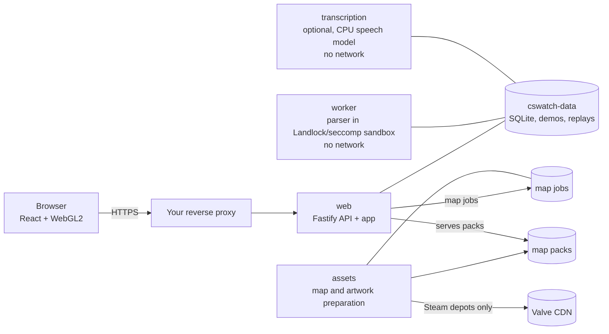

# cswatch

A self-hosted review room for Counter-Strike 2 demos. Upload a `.dem` (or import it from Steam or FACEIT) and watch the match in the browser, on the game's own maps, from any player's eyes or from above. It runs on an ordinary CPU-only server behind your own HTTPS reverse proxy.

- [Features](#features)
- [Quick start](#quick-start)
- [Configuration](#configuration)
- [How maps are prepared](#how-maps-are-prepared)
- [Operations](#operations)
- [Architecture](#architecture)
- [Security](#security)
- [Development and tests](#development-and-tests)
- [Licenses and notices](#licenses-and-notices)

## Features

- **Native CS2 3D replay.** Maps are built from Valve's compiled worlds: the game's meshes, materials, baked lightmaps, light probes, cubemaps, fog and color grading, drawn by a WebGL2 port of the CS2 shaders. Doors, breakables and smokes follow the recording.
- **Cameras.** First-person POV with the player's recorded aim, follow, free camera, overhead with player arrows through roofs, and a calibrated 2D radar view.
- **Phones and TVs.** Desktop GPUs get a BC texture tier and phones an ASTC tier; devices with neither get the 2D map. Touch, keyboard and remote navigation throughout.
- **Review tools.** Round and event timeline, kill and utility review, scoreboard, economy, recorded inputs, crosshairs, game sound, recorded voice and private notes.
- **Captions.** Optional offline speech-to-text for recorded voice, on the CPU, with no audio leaving the server.
- **Private by default.** Demos belong to their uploader until explicitly shared. Optional public guest uploads, closed private instances, passkeys and two-factor sign-in.
- **Steam and FACEIT.** Import Premier, Competitive and Wingman matches from Steam match history or the local CS2 replays folder, and FACEIT matches with an approved download token.
- **English and French**, light and dark themes.

Feature details and current limits: [feature status](docs/STATUS.md).

## Quick start

Requirements: Linux with Docker Compose and Landlock ABI 3 or newer (kernel 6.2+), a reverse proxy that terminates HTTPS, about 8 GB RAM for the web and parser services, plus an 8 GB limit for the optional map worker, and disk for demos and prepared maps (see [How maps are prepared](#how-maps-are-prepared)).

```sh
curl -fsSLO https://raw.githubusercontent.com/Buco7854/cswatch/main/compose.yaml
curl -fsSL -o .env https://raw.githubusercontent.com/Buco7854/cswatch/main/.env.example
# Set APP_URL in .env to your public HTTPS origin, e.g. https://cswatch.example.org
docker compose config --quiet
docker compose pull web worker assets
docker compose run --rm worker ./dist/parser-sandbox --check
docker compose up -d web worker assets
```

Then open `APP_URL/setup` and enter the one-time code from `docker compose exec web cat /data/setup-token` to create the first administrator (or set `ADMIN_USERNAME` and `ADMIN_PASSWORD` in `.env` before the first start). There is no default password.

Point the reverse proxy at port 8000 of the Docker host (`HOST_BIND_IP` and `HOST_PORT` change the published address). Keep the original `Host` header, allow uploads up to `MAX_UPLOAD_MB`, and set `TRUSTED_PROXY_IPS` to the proxy's address if it should supply client IPs. More: [access setup](docs/ACCESS-SETUP.md).

## Configuration

Only `APP_URL` is required. [`.env.example`](.env.example) lists every setting with its default and purpose; uncomment a line to override it. Instance policies (public access, guest uploads, registrations, Steam, FACEIT, email, captions, automatic maps) can be left unset and changed by administrators in the app; setting one in the environment locks it.

| Topic                                 | Guide                                                                                                       |
| ------------------------------------- | ----------------------------------------------------------------------------------------------------------- |
| First administrator, guests, privacy  | [Access setup](docs/ACCESS-SETUP.md)                                                                        |
| Steam and FACEIT                      | [Providers](docs/ACCESS-SETUP.md#steam-and-faceit)                                                          |
| Email verification and password reset | [Email](docs/ACCESS-SETUP.md#email-delivery-verification-and-password-reset)                                |
| Captions                              | [Speech model](tools/transcription/README.md), then `TRANSCRIPTION_ENABLED` and the `transcription` profile |
| Maps                                  | [Map assets](docs/MAP-ASSETS.md)                                                                            |

For captions, prepare the model once, mount it read-only into the transcription service (for example with a `compose.override.yaml` volume `- /srv/cswatch-models/whisper-tiny:/models/whisper-tiny:ro`), set `TRANSCRIPTION_MODEL_DIR=/models/whisper-tiny` and start it with `docker compose --profile transcription up -d`.

## How maps are prepared

A demo records the match, not the level. The `assets` service prepares each official map the first time a viewer needs it (when automatic preparation is enabled with `AUTO_OFFICIAL_MAPS_ENABLED` or in Administration):

1. It downloads only that map's files from Valve's public Steam depots (anonymous, no game install, no Steam login), verified against the depot manifest. Official community-addon maps also get their addon content.
2. Networkless, resource-limited child processes export the compiled world with a pinned .NET 11 exporter built on ValveResourceFormat, pack geometry with meshoptimizer, keep Valve's texture blocks for the desktop tier and encode an ASTC phone tier, and render a radar when the game lacks one.
3. The pack is validated (every file hash-bound) and published atomically. It is served only to viewers of demos on that map.

On a 3-CPU test host a map took 2–6 minutes including the download, and the viewer shows each phase while it waits. Packs are a few hundred MB per map (desktop and phone tiers together); baked lighting keeps its full shipped resolution, so desktop downloads range from about 70 to 390 MB. The worker caches downloaded map files in its cache volume (five maps took 8 GB) and refuses to start a job that would leave less than 4 GiB free. Without a pack, the viewer falls back to the 2D radar. Custom and Workshop maps are not prepared automatically.

Details, approved historical sources and troubleshooting: [map assets](docs/MAP-ASSETS.md) · [exporter](tools/cs2export/README.md) · [operator tools](tools/assets/README.md).

## Operations

**Updates.** `docker compose pull web worker assets && docker compose up -d web worker assets` (add `--profile transcription` and `transcription` if used). Pin images with `CSWATCH_IMAGE` and `CSWATCH_ASSETS_IMAGE`. Each image carries its source revision, shown in Administration.

**Backups.** Stop all services and back up the `cswatch-data` volume (SQLite, originals, prepared replays) and the `cswatch-map-assets`, `cswatch-map-jobs` and `cswatch-map-catalog` volumes. `cswatch-map-cache` can be rebuilt.

**Account recovery** from the host:

```sh
docker compose exec web node dist/cli.js list-admins
docker compose exec web node dist/cli.js reset-password USERNAME
docker compose exec web node dist/cli.js reset-factors USERNAME
```

**Storage and retention.** Defaults accept demos up to 512 MB (2 GB expanded), 2 GB per user and 20 GB overall; demos expire after 30 days (`RETENTION_DAYS=0` keeps them). See `.env.example`.

## Architecture



The web service handles accounts, uploads and streaming of prepared replays and map packs. The parser worker turns demos into bounded replay chunks in a sandbox with no network or access to other users' data. The assets service is the only component with outbound network access, limited to Valve's depots; its conversion children have none. More: [architecture](docs/ARCHITECTURE.md) · [native renderer](docs/product/NATIVE-RENDERER.md).

## Security

Every service runs as a non-root user with a read-only filesystem, dropped capabilities and memory, CPU and process limits. Uploads are parsed in a required Landlock/seccomp sandbox; unsupported kernels fail closed. Requests are checked against `APP_URL` (Host, Origin, CSRF). Provider keys and encryption keys stay server-side; saved Steam codes are encrypted with the instance key. See [SECURITY.md](SECURITY.md).

## Development and tests

Node 24, npm, and on Linux a C compiler for the sandbox launcher. The exporter needs the .NET 11 SDK ([exporter build](tools/cs2export/README.md#build-inputs)).

```sh
npm ci && npm ci --prefix backend && npm ci --prefix frontend && npm ci --prefix tools/assets
npm run build
cd backend && APP_URL=http://localhost:8000 COOKIE_SECURE=false npm start   # and `npm run worker` in another terminal
```

```sh
node scripts/fetch-test-demo.mjs   # checksum-pinned public Mirage fixture
npm test                           # backend: security, replay logic, parsing
npm run test:assets                # asset worker, preparation and publication
npm run test:graphics              # capture and reference checks
npm run test:e2e                   # browser journeys on an isolated server (port 4174)
E2E_PRIVATE=1 E2E_REGISTRATIONS=false npm run test:e2e
E2E_PRIVATE=1 E2E_REGISTRATIONS=true npm run test:e2e
npm run test:e2e:email             # signup and recovery against a loopback SMTP relay
npm run format:check && npm run check:locales
```

Install Playwright's Chromium with `npx --prefix frontend playwright install chromium`. Exporter tests: see [tools/cs2export](tools/cs2export/README.md). The data directory defaults to `var/`; a database from another schema is refused rather than migrated. Contributor guide: [AGENTS.md](AGENTS.md) · [handoff](docs/HANDOFF.md) · [verification record](docs/VERIFICATION.md).

## Licenses and notices

cswatch is licensed under the [GNU AGPL v3](LICENSE).

- Material, lighting and world-traversal logic is ported from [ValveResourceFormat](https://github.com/ValveResourceFormat/ValveResourceFormat) 21.1 (MIT): [notice](tools/cs2export/THIRD_PARTY_NOTICES.txt), also shipped in the [browser bundle](frontend/public/licenses/valve-resource-format.txt).
- The asset worker builds pinned [astc-encoder](https://github.com/ARM-software/astc-encoder) 5.7.1 (Apache-2.0) and [Convection Texture Tools](https://github.com/elasota/ConvectionKernels) (MIT), and uses the .NET 11 SDK (MIT), meshoptimizer (MIT) and three.js (MIT).
- The browser bundle ships the [csgo-sharecode](frontend/public/licenses/csgo-sharecode.txt) (MIT), [Barlow Condensed](frontend/public/licenses/barlow-condensed.txt) and [IBM Plex Sans](frontend/public/licenses/ibm-plex-sans.txt) (OFL) notices, and Steam and FACEIT glyphs from Simple Icons (CC0-1.0) with a [brand notice](frontend/public/licenses/provider-brands.txt).

No game content is included in this repository or its images: maps, models, sounds and artwork are prepared on your server from Valve's depots. Counter-Strike and Valve are trademarks of Valve Corporation; cswatch is not affiliated with Valve, Steam or FACEIT.
