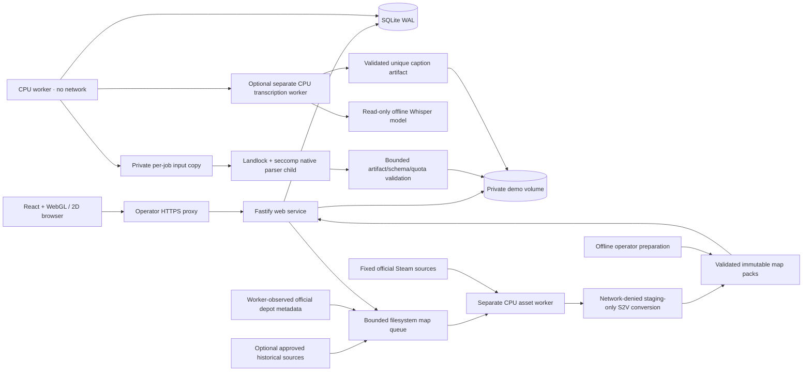

# Architecture

## Deployment and data flow

The web process authenticates requests and streams uploads. It does not parse demos or decompress untrusted files. The worker atomically claims a queued row, copies its input into a random job directory, and starts the native parser through a required Linux Landlock/seccomp launcher. The child reads runtime code/libraries and reads/writes only its job. Database, other demos and provider environment are outside its boundary. Forks, network and process escape are denied; native threads remain usable. Unsupported kernels fail closed. Timeout/cancellation kills the process group before output validation. Container memory/process/CPU limits bound native allocations; V8 heap limits alone do not bound native memory.

The parent incrementally polls bounded scratch files, validates compressed artifacts and versioned domain shapes, copies accepted regular files into a pending directory, and promotes them only if the row still owns the processing state and output fits quotas. Summary comes from the validated manifest. Failed publication removes promoted fragments; housekeeping reclaims stale jobs. Polling leaves a disk-write race, so host filesystem quotas remain the hard disk boundary. See `parser-job.ts`, `replay.ts` and SECURITY.md.

One SQLite database and one local data volume make deployment and backup straightforward. This is a **single-host architecture**. Multiple workers can claim jobs, but share I/O and each need expansion/memory headroom. Do not mount SQLite on network storage or scale web replicas across hosts. A larger installation should replace the store with PostgreSQL, use object storage, and keep the replay/provider interfaces. No Redis is required for this release.

Compose starts the long-running `assets` service in the normal stack, using a separately published image. Automatic map acquisition still defaults off under its independent env/admin policy. The service mounts prepared assets read/write, shared jobs, a read-only catalog and private source/tool cache; it has no application data/account/provider mounts or `.env`. Web reads prepared assets/catalog read-only. Update with `docker compose pull web worker assets` followed by `docker compose up -d web worker assets`, rather than updating only the web/parser image.

CI embeds immutable full source revision and UTC build time in OCI image labels and the web build file. `build-info.ts` strictly validates that bounded local file; `/api/config` returns its non-secret fields with no-store caching, and Administration displays them. Unknown local-build values remain null rather than being inferred from a mutable environment. CI verifies the running container's identity against the expected source. This identifies the build; exact-revision workflow evidence remains a separate release gate.

Queue states: `uploading → queued → processing → ready | failed`. Quotas reserve maximum upload size before accepting bytes, then record actual original size; prepared compressed output is added after success. Stale uploads expire. Interrupted parser jobs become failed after their deadline instead of endlessly retrying crash inputs. Failed originals remain until owner deletion or retention. Worker polling is two seconds; maintenance runs every minute.

## Replay contract

The browser playback clock follows monotonic elapsed time rather than a capped per-frame delta. Delayed rendering can skip visual frames, but must not slow the recording itself. The clock only advances through contiguous already-decoded chunks and rebases across seeks, speed changes, hidden tabs and buffering; waiting for missing data never creates catch-up jumps. Canonical cached views are synchronously available at chunk boundaries. One pure recorded-pose sampler shares shortest-angle yaw/pitch, position and duck interpolation across cameras, agents and POV equipment, with identity/death/round/gap/teleport guards. Inventory, inputs and counters remain sampled recorded state.

Gameplay audio is additive optional chunk data, separate from the global review-event list and recorded communications. The confined stream reader resolves fixed native SOS/weapon-sound tokens, exact supported position parameters and stop IDs; game events provide explicit shots, objectives and round outcomes. The browser uses representative native samples rather than recreating Source2's full sound graph. A 100,000-cue bound, per-second density cap and 4,096-cue chunk bound keep this optional evidence separate from primary replay limits. If optional audio makes output exceed its budget, the writer retries primary data intact and publishes unavailable/truncated audio coverage.

The isolated assets service acquires only the fixed official sound registry, with its selected Steam manifest and CRC/hash proofs. S2V and offline MPEG normalization run with required stage-only writes and no network/process escape. Published banks contain bounded PCM WAV only, installed by same-parent no-replace rename. An idle bootstrap has bounded attempts and shares Steam's cooldown without changing map/replay job state. Payload GETs validate fresh hashes and retain admission through response completion; lightweight catalog reads use bounded immutable descriptors. The browser shares one lazy context between voice and gameplay, validates PCM before decoding, bounds resampled output/cache/sources and flushes on transport or identity changes.

`shared/playback.d.ts` defines the in-memory rendering data and the version 3 streamed transport. Player IDs are strings; positions/angles use Source coordinates. The parser samples player state every four recorded ticks and retains off-grid recording endpoints, and the renderer interpolates positions and shortest-angle yaw between adjacent samples. Events retain recorded ticks. Round starts/live starts/ends and timeout/freeze segments come from parsed events/game rules. Native rows are grouped/sorted explicitly. Grenade paths sample recorded projectiles; entity ID reuse is separated when there is a gap.

The server checks access independently on the manifest and every chunk. Prepared output consists of `manifest.json.gz` and `chunks/<index>.json.gz`. The manifest retains global events/rounds/dead-time indexes, whole-match ticks and Source-coordinate world bounds. Each chunk has at most 480 new samples, one shared boundary frame and 80 preceding spatial frames for five seconds of trail context. Actual UTF-8 frame/trajectory/voice bytes determine the number of new samples under the 4 MiB bound. Primary frames and boundaries retain full recorded state. Preceding trail frames retain spatial state and optional flash duration. A HUD query for a recorded tick loads the authoritative chunk for equipment, inputs and statistics. Trajectories include adjacent points. Global bounds prevent camera/radar shifts between slices.

`replay-cache.ts` keeps at most three decoded slices and two current requests, prefetches forward and cancels irrelevant transfers on seek. `useReplay.ts` owns polling, identity-safe lifecycle, initial loading, buffering and retry. The controller owns user time/camera decisions; playback pauses during buffering. `playback.ts` stays independent of Three.js and uses the global last tick for timeout skips. Limits are 4 MiB decoded per chunk, 16 MiB metadata, 512 MiB aggregate decoded chunks and 160 MiB stored output, validated before publication. These bounds do not certify real-device performance.

Chunks can carry an aim track for the primary tick range. It records living players' yaw and pitch on each available source tick with wrap-safe quantized deltas. One shared decoder bounds and validates the stream before publication and browser hydration. Adjacent chunks duplicate the same quantized boundary sample. The shared pose sampler uses verified adjacent aim ticks for angles and keeps primary frames for position and categorical state. The sampler interpolates angles from the primary frames wherever per-tick aim evidence is missing. [Aim metadata](REPLAY-METADATA.md#recorded-aim)

The manifest can carry a bounded optional horizontal travel anchor per chunk and player. The writer records it at the actual byte-adaptive boundary. The viewer rebuilds the local travel series from the anchor and interpolates measured interval velocities across surrounding frames. First-person weapon movement uses demo-time phase where a travel anchor is unavailable. Teleports, round boundaries, dead pawns and gaps do not add travel. [Replay metadata](REPLAY-METADATA.md#locomotion-and-c4-presentation)

Display settings live only in the browser. Account data, visibility, and notes stay on the server. The synthetic sample is deterministic and independent of database data. Its authored EN/FR subtitle preview is explicitly labeled, contains no recorded audio and never calls transcription APIs. Calibrated overview images provide the full 2D map and compact radar without WebGL. For real demos, missing or failed 3D falls back only to a decoded calibrated overview. With neither usable geometry nor overview, the scene explains that the map is unavailable. It never renders actors on an empty plane. The labeled synthetic practice scene remains independent.

Recorded input/economy fields are optional and accompanied by explicit capabilities. Optional native query groups fall back independently; unavailable input must not erase available money/equipment data. Button masks stay uint64 decimal strings. Key labels are conventional actions (WASD/ZQSD), not recovered physical bindings; input state is sampled at 16 Hz. `review-events.ts` groups recorded events and matches player IDs. `timeline.ts` projects events onto the whole-match or current-round axis; `ReplayTimeline` shares that axis with the native seek thumb, preserves exact event stems and exposes crowded markers through named menus. Scrubbing pauses playback and freezes round bounds during the drag. Compact 32 × 24 px event targets own the upper part of a 44 px timeline row; the bottom 20 px remains unobstructed for native scrubbing. Event glyph hit-testing, keyboard menus and exact endpoint/midpoint seeks share the native thumb axis. Timecodes sit alongside this row, with a separate round-segment lane above the markers. Timeline settings use a native modal portalled into the viewer so fullscreen/hidden-dock behavior stays correct. `RoundEventReview` retains the full filtered detail list.

## Spectator HUD and operator artwork

`ReviewHud` positions independent inputs and equipment at the scene edges. The optional mouse sits alongside movement keys with action/modifier keys beneath; optional source/raw details are controlled through Options. On wide/tall screens, the default split layout places CT at the left edge and T at the right; a saved right-only preference and the narrow/short-screen fallback use one combined stack. Both layouts retain each immutable player identity exactly once. Normal-flow identity, equipment and status rows keep utilities clear of health/armor. Side colors and only a selected-row highlight identify the teams/observer. They scroll internally on compact screens; the shared `useLineupViewport` ResizeObserver constrains each viewport to actual complete-row boundaries while retaining every player and focused-row scrolling. A persistent noninteractive cue tracks native scrolling, including touch browsers that hide their scrollbars. There are no inline display/collapse controls. Complete inventory lives in the Players drawer. `viewer-layout.css` is the sole owner of the full-viewport shell and responsive density, with independent floating identity/action groups and an inset playback deck. Short landscape retains the same timeline/transport rows and places captions beside inputs. `viewer-presentation.css` owns palette/visibility and matching viewer dialogs/portaled menus. The measured deck safe area includes its bottom inset. Language/theme/account/demo actions share Viewer menu; AccountMenu accepts supplemental actions without duplicating logout behavior.

`useViewerChrome.ts` separates persisted manual `controlsHidden` from transient playback idle hiding. Primary scene taps under 500 ms/8 px toggle visibility; movement, secondary pointers and canceled gestures prevent a tap. Three-second auto-hide is optional and does not interrupt floating surfaces, active gestures, buffering, panels or keyboard focus. Chrome fades with inert/ARIA state and keyboard recovery; mouse movement, H and Tab reveal it. Inputs, roster, radar, objectives and controls share visibility, while captions remain independent and reposition above the current deck safe area. Pausing restores transiently hidden controls. Mouse/input-details preferences default false; `autoHideControls` defaults false. H ignores text fields, managed menus and native/ARIA dialogs.

`review-prompts.ts` indexes global recorded events independently of current frame/trajectory chunks. Immutable observed-player IDs, known utility types, strict entity lifetimes and unambiguous owner matching associate actual detonation coordinates; bounded/dense or conflicting data suppresses suggestions. No chunk endpoint becomes a claimed landing. Binary clock lookup handles seeks. Optional `ReviewActions` live outside fading chrome. `review-moments.ts` compiles global combat/throw records and per-player binary lookups once, independent of streamed frame slices. Explicit killer/victim actions select that immutable player and POV; throw replay selects the thrower’s POV. Landing jumps near the recorded detonation in the ordinary free camera. Current speed is preserved; 2D stays 2D. No temporary clip, end stop, saved return state or back button exists. Existing 2D stays 2D. A short-lived detonation annotation can expire without changing playback or the camera. A new Free visit uses a recorded living-player eye or a clear overview.

`utility-state.ts` interpolates only between recorded projectile samples and builds analytical effects from actual event positions. Scene quality controls resolution/shadows/model tier; it never removes utility state. Projectiles render from their first sample even when path lines are disabled. The 2D map and radar use the same overview transform for player positions, directions, projectiles, paths, effect radii and review targets. A usable overview is required before these 2D layers render for real demos. The compact radar uses one translucent black backdrop without dimming its image or markers; the full 2D view uses a neutral ground. Auto classifies the active WebGL context before acquiring a map model. Software and resource-limited contexts prefer Compact, mobile and integrated GPUs prefer the lighter detailed map tier, and recognized discrete and Apple M-class GPUs prefer the desktop map. Viewport, pointer and CPU hints are used when the adapter is masked. Playback can still adapt resolution within the chosen tier. Caption overlay height is measured with ResizeObserver and shared through a safe-area variable, keeping optional input/roster/action surfaces above multilingual captions.

`objectives.ts` captures recorded arming, planted-fuse and defuse deadlines. Absolute server clocks are mapped through the actual `net_Tick` packet and recorded tick interval, not relative reader time or later explosion events. `objective-state.ts` compiles global snapshots/lifecycle events once and answers arbitrary seeks with binary lookup. It handles abort, death, round reset, partial metadata and recorded outcomes; a zero countdown never invents completion. Missing deadlines show elapsed time. `ObjectiveHud` renders actor/site/kit, icons and progress without announcing every timer update to screen readers.

`shared/equipment-icons.json` is the only equipment registry. The trusted `tools/assets/prepare-equipment.mjs` converts operator-exported drawing-only SVG to bounded PNG with source/output hashes. Game artwork stays outside Git and images. `/api/assets/equipment` exposes validated fixed filenames under the instance access policy; descriptor-anchored, no-follow Linux reads reject symlinks/hardlinks, malformed PNGs and unrecognized paths. A bounded cache is revalidated against file identity. Only explicit asset routes serve prepared artwork and models. `ReviewEventGlyph` maps native demo kills to the circled crosshair and deaths to the skull; plant/defuse/explosion use distinct native HUD assets. `equipment-key.ts` resolves exact recorded aliases for model, artwork and shape lookup. `equipment-icons.ts` shares one local manifest across glyphs and accepts only exact same-origin registry URLs; there is no runtime CDN or arbitrary fetch.

## Recorded scores, counters and review layout

See [replay metadata](REPLAY-METADATA.md) for shared contracts, raw property sources, availability and bounds. `match-state.ts` reuses the existing ALL entity reader for CCSTeam scores/game-rule phases and clocks. `Position.stats` comes from an independently optional native controller-counter query group. Successful event queries describe a recorded segment, not all prior match history: never reconstruct match K/D/A/HS%/damage from zero using segment events. `match-stats.ts` uses only recorded current-frame counters and returns unknown for missing fields; incomplete match-state timelines cannot extrapolate beyond their final sample. The current manifest records completeness and unavailable native evidence remains unknown.

`throwInputs` binds global event index, exact tick and immutable actor to bounded input evidence. Event-network masks are snapshots, not verified physical launch/release commands; missing/ambiguous data stays unavailable. These global annotations survive chunk eviction and private/shared publication. `ThrowInputBadges` shares this evidence between toast and review list.

`MatchScore` and `Scoreboard` use the same recorded match timeline. Holding plain Tab opens the native scoreboard when replay/frame data is ready and focus is outside typing, menus and dialogs. Keyup/Escape/blur close safely. Shift+Tab remains backwards focus navigation. Compact `ReviewFeed` is a real modal that replaces background instruments until Close/navigation; the desktop round list stays inline. One toast chooses the newest enabled combat/utility moment. `combat-recap.ts` aggregates only immutable-ID player_hurt records from a known round start through that elimination. Query/round coverage determines complete/partial/unavailable states, with no invented kill damage. The compact recap remains enabled on mobile independently of the default-off Kills/Utility panel. `useReviewLayout` measures objective/feed footprints; toast height and caption gutter are measured independently. The centered deck separates the timeline round lane from event markers. Kill replay prompts sit above the deck. The desktop input instrument can use the bottom-left lane. Radar and native feed/objective bounds participate in collision checks.

## Communications and CPU subtitles

`communications.ts` uses the typed `cs2parser` reader inside the existing parser sandbox. One incremental entity world also observes C4 and player-controller state; only changed objective snapshots are retained, capped at 10,000. `voice-packets.ts` validates bounded Steam containers/CRC and raw Opus framing; unsupported data produces a capability/warning, never guessed speech. The manifest holds bounded text chat and communication status; chunks hold bounded voice packets with immutable speaker IDs and recorded times. `voice-playback.ts` decodes locally with trusted bundled libopus WASM, caps decoder/scheduling state, and resets scheduled audio on seeks/pauses. CSP permits WebAssembly compilation without permitting general JavaScript eval. Recorded communications share their demo's access policy.

Schema v4 adds an independent transcription state, start time, claim lease, byte count and artifact pointer. Optional `transcription-worker.ts` claims ready replay jobs without changing primary replay status. It copies validated slices, grants a dedicated model directory read-only, and starts `transcription-job.js` under the same kernel boundary. Local-only Whisper CPU inference groups bounded speaker utterances, suppresses silent input, detects or accepts a language, and emits timed cues. Parent validation checks bounds/speakers/content/size before publication. Unique `captions-<lease>.json.gz` artifacts and a transactional DB pointer prevent stale workers or rollback from replacing another result. Quotas include captions. Cancellation, graceful shutdown and stale/orphan cleanup preserve the ready replay.

`WORKER_ROLE=parse|transcription|all` separates scheduling; Compose uses a normal parser and an optional networkless transcription profile so long speech jobs do not delay uploads. Runtime model downloads/cloud fallback are disabled. `tools/transcription` prepares checksum-pinned weights and public speech fixtures offline from the application. `Communications.tsx` owns optional voice/chat/subtitle controls and caption polling; outputs are approximate and carry provenance. Text is rendered as text, never HTML. Encrypted or missing content stays unavailable.

## Rendering and S2V

S2V exports game content offline, using its CLI and the operator's installed game files. The preparation tool packs textures into GLBs, optimizes them, emits desktop and mobile variants with a SHA-bound GLB and texture plan for each tier. Export/optimization is CPU work, not real-time server rendering. Assets are installed by the operator, not uploaded through a public API.

The same preparation stage derives an optional Compact 3D GLB from the hash-bound mobile tier. It bakes static world placement and source material colors into spatial batches, applies bounded simplification and quantization, and uses lossless Meshopt transport. Publication validates the derived bytes, texture-free geometry bounds and exact mobile source hash. The fixed tier route shares existing map access, descriptor and content-proof checks. Auto selects it on low-capability profiles, while explicit quality and camera preferences remain independent. If compact is absent or fails to load, the viewer uses the detailed tier when available.

The operator installer can acquire explicit selected maps and dependency chunks from Steam anonymously. It pins a depot manifest, verifies local VPK entry CRCs and follows bounded Source 2 references. The compiled world binds supported irradiance, direction and stationary sun shadow inputs. `map-baked-lighting.ts` loads the material extension inside the map's texture and model lease. The atlas uses secondary UVs and the paint shader reads its separate vertex blend attribute. Unsupported atlas formats keep ordinary PBR with a fixed provenance reason. Local probes, unbound vertex lighting and game scripts remain separate. A selected map’s authored sky prefab and cubemap are prepared independently of the replay worker and public API. Game assets remain outside Git and the application image.

Optional automatic acquisition uses `map-identity.ts`, `map-catalog.ts`, `map-jobs.ts` and `demo-map-assets.ts`, with contracts in `shared/map-acquisition.d.ts`. The confined parser records bounded raw map/build/patch/GUID/addon evidence. These unsigned header fields do not identify map contents. A unique operator-approved historical source is preferred. Otherwise a worker-generated current official inventory can select a disclosed latest snapshot by safe bare map name. Explicit addon/conflicted evidence remains blocked. An approved source that fails with `source_unavailable` may use a fresh latest selection, while integrity and removed-approval failures remain terminal for the selected source. GET is read-only. Owner/guest POST requires exact Origin, CSRF, policy, healthy worker and queue/rate capacity.

`official-map-inventory.mjs` performs only a fixed anonymous app 730/depot 2347770 listing. Direct map entries become a bounded atomic inventory in the job volume, refreshed at startup/hourly with failure backoff. New selection requires metadata within 24 hours. No map whitelist update or default catalog mapping is needed for newly listed official names. The selected manifest, exact map SHA-1 and size remain pinned throughout acquisition. The installer checks them and computes SHA-256 before conversion. Latest queue IDs hash the metadata selection, while separate content pack IDs include the downloaded SHA-256. Approved jobs retain approval-derived pack IDs.

First-use pinned tool preparation has its own 20-minute cap, followed by a fresh 180-second inventory deadline and 120-second listing-child cap. The stripped bootstrap environment puts HOME, CLI state and single-file extraction under private disposable staging, rather than the read-only image home. Those directories are removed before complete tool provenance is recorded. Existing verified caches remain usable. Safe preparation/ready events and bounded exit status supplement fixed failure codes without logging native output.

`map-management.ts` exposes administrator map inventory and hash-bound removal requests. Prepared assets remain read-only in HTTP. The serialized asset worker verifies the current request generation and immutable pack marker, retires that exact pack with same-parent `RENAME_NOREPLACE`, records `removed_by_admin` and erases only bounded known owned files through directory descriptors. Existing quarantine paths and foreign/operator files remain untouched. New delivery is suppressed as soon as removal is queued, while already-open streams retain their descriptors. Recovery keeps its original authority through interruption. Reacquisition requires an explicit normal owner retry after cleanup.

Shared native actors, HUD artwork and equipment models are separate from map packs. `install-presentation-assets.mjs` uses fresh official inventory, fixed registries, selective CRC/hash-verified resources and required stage-only conversion. Actor/icon banks publish atomically. Equipment models publish one fixed identity per idle turn, retaining their own manifests. Core actors/icons precede idle artwork/audio, and bulk models yield between items to map work. An incomplete or interrupted preparation retains durable attempt limits and owned-stage recovery evidence. Each category pins its selected manifest and matching private source cache across inventory refresh, restart and explicit retry. Category sources can differ, but continued equipment models retain their owned bank's source. Retry intents bind a canonical full-failure hash and current terminal/cooldown policy at enqueue and consumption, so a newer same-generation failure cannot be reset by stale authority. All optional idle acquisition requires a successful inventory observation within twenty-four hours. Safe administrator status never exposes native output or caller-selected versions. Operator banks are preserved rather than silently rewritten. Permanently unavailable pinned sources require coordinated operator recovery, with no automatic migration/reset control.

`asset-discovery.ts` gives each mounted viewer a finite read-only observation lease, independent of acquisition requests. Agent/model/artwork catalogs can become ready during playback without re-uploading a demo. Valid partial data survives transient errors. Completion or access denial stops observation, and unmount/identity retirement cancels it. A missing weapon image retains its recorded name until exact native artwork is available.

The asset service has no app database, accounts, provider credentials or parser volume. It acquires bounded exact resources and confines S2V/Node conversion subprocesses to networkless, stage-only writes. The supervisor still performs bounded Sharp operations outside that child boundary. Source policy is rechecked between stages and before complete desktop/mobile/overview/environment publication. Latest proof is persisted before conversion, and a strict pack marker binds request, selection and actual content. A content-named stage publishes through exclusive same-filesystem no-replace rename. Existing immutable packs are never overwritten.

Flock serializes workers, bounded heartbeats expose availability, and a durable three-attempt generation budget prevents restart loops. Transient failures require an explicit owner retry after cooldown. A latest retry keeps valid source proof so an already-published pack can recover without re-download. The browser bounds polling and does not retry failures automatically or cancel shared jobs on navigation. Approved URLs revalidate current catalog approval. Latest URLs revalidate their ready request/result/marker and official-name membership, preserving old immutable snapshots across inventory updates. Stale inventory can serve a valid cached snapshot but cannot authorize a fresh acquisition. Manual packs remain separately version-unverified. See [deployment](MAP-ASSETS.md) and [matching limits](product/MAP-ACQUISITION.md). Map request and pack identities include the preparer format revision. The worker revalidates ready output when its file identities change and rebuilds missing or invalid packs using the same request, attempt ledger and bounded retirement path. Versioned presentation banks and status documents isolate old output generations.

`map-readiness.ts` shares one bounded local snapshot of policy, worker heartbeat, official inventory and historical catalog between demo discovery and administrator diagnostics. Missing/stale inventory and an absent worker receive operational reasons rather than a misleading historical-approval error. Inventory failures carry validated storage/toolchain/downloader/metadata/publication phase, fixed code, timestamp/retry time and optional bounded exit code. The worker retains this safe failure in heartbeats and structured logs until a successful refresh clears it. Only administrator diagnostics expose the detailed failure; ordinary demo discovery retains its coarse readiness reason. No raw errors, paths or credentials are returned, and diagnostics perform no network request. `useDemoMapAssets.ts` rechecks bootstrap reasons after 2/5/15/30 seconds for at most 45 minutes. Eligible owner/guest state can then create one normal immutable-source request. An explicit availability refresh remains read-only; failed conversions retain their separate manual retry policy. An empty historical catalog does not block a fresh latest-official Ancient selection.

While idle after a successful inventory refresh, the worker prepares shared presentation and checks fixed landing artwork before the native sound bank, rechecking queued maps between banks and items. `install-map-preview.mjs` selects only the fixed official 720p Mirage VTEX and its index, verifies SHA-1/CRC/hash evidence and copies source bytes into a conversion-only root. S2V decoding and reusable Sharp normalization both run as network-denied, stage-only children; no converter writes downloader controls or cached tools. The bounded PNG and metadata publish under `previews/<fixed map>` through the exact same-parent no-replace helper. Any existing fixed operator preview is preserved. A five-minute task deadline, bounded attempts, prepared-output accounting, disk reserve and shared Steam cooldown remain independent of map/replay readiness. `map-preview.ts` serves fixed hash-bound local artwork under setup/private policy, and `LandingBackdrop` polls missing artwork within a bounded window. No game screenshot is bundled in an image or loaded from a remote fallback. Artwork is decorative, not map-version or overview evidence.

`map-model-files.ts` serves the fixed `<map>/(desktop|mobile|compact)/scene.glb` and `agents/(ct|t).glb` paths through descriptor-anchored, no-follow regular-file reads. Discovery shares the same bounded GLB opener. A fresh streamed digest supplies ETags, without allocating the complete model. GET, HEAD and single ranges preserve instance policy. Disconnect cancellation spans opening, hashing and streaming, with exclusive descriptor ownership and send-failure cleanup. Only explicit asset routes can serve map and actor files.

`map-assets.ts` in the backend reads descriptor-anchored regular overview metadata and bounded PNGs, verifies their hash binding and serves only fixed local paths under instance access policy. The browser's shared discovery state is scoped to demo/map identity and retries failed requests on remount. `tactical-coordinates.ts` uses recorded Source inches: normalized X is `(x - origin.x) / (1024 * scale)` and normalized Y is `(origin.y - y) / (1024 * scale)`. Raster resolution does not change the calibration. Valve’s overview `rotate` field may be absent, zero or one. It controls the in-game panel while the raster keeps its north-up calibration. Other rotation values and nested floor layers are rejected.

Prepared packs are immutable for an application session. GLTFLoader caches fixed model URLs; operators stop active viewers, install a new complete pack and reload tabs. In-session hot replacement is not supported.

GLB readiness requires the model to parse and its rendered materials' required base-color images to decode. A failed map model leaves the calibrated 2D view usable when its overview has decoded; otherwise Map unavailable replaces the scene. Compact radar is omitted when its overview is unavailable. Required model loading and texture decoding finish before real-map actors render. Imported lights are disabled on a cloned map, leaving the cached glTF untouched, because World owns approximate lighting and S2V engine intensities otherwise saturate it. Embedded WebP images require browser-local `blob:` fetches in CSP `connect-src`; network destinations remain restricted to the same origin.

The camera picker derives the visible 2D fallback from the current renderer report. Explicit 2D stays independently selectable. Selecting an available 3D camera after a model or WebGL failure remounts the scene as a new attempt. Replay tick and selected player live outside that attempt. Each renderer report belongs to the current demo, account and attempt. A missing asset disables 3D selections until discovery reports an available tier. The loading screen subscribes directly to the current scoped cache entry rather than updating the replay on each progress event. Its percentage describes transfer bytes from a computable total. Discovery, unknown length, overview decoding and validated-model preparation use indeterminate phases. Optional sky and equipment readiness stay separate.

The browser loads map geometry and applies replay positions. Standard glTF PBR differs from Source 2's shaders. S2V’s ordinary map export omits important lighting/sky information. The selective installer resolves the actual skybox_reference, exports its prefab, records the sky_camera origin/scale/reference transform and merges tagged landscape geometry into both map tiers. The renderer extracts that landscape into a separate scene, draws it first with extended sky-camera depth, clears depth, then draws the main world without changing its projection. Six locally prepared cubemap faces supply the background with authored orientation/tint/exposure, independently of the HUD theme. The graded scene combines authored map lighting with bounded fallback inputs. The smoke volume uses journal density when available and analytic density at the observed origin otherwise. Fire uses observed burning points when available and a procedural event patch otherwise. Optional agent models use private cloned skeletons. Directional poses blend authored strides using recorded movement, stance and aim. Recorded actions drive upper-body layers and death poses persist until round end. Missing or invalid agent models use capsule bodies. Exact bone animation and the native graph remain unavailable.

`item-state.ts` observes world equipment in the existing streaming entity pass. Serial-bearing entity identities, explicit owner/root-parent handles, item definition indices, cell origins and complete recorded angle tuples supply dropped items, grenade bodies and planted C4. Missing fields never become origin-zero placements or guessed drops. The observer bounds active entities and changed samples, reserves removal capacity, and reports separate dropped/planted/projectile coverage. Streamed chunks carry the actual live state into their first time slice under the unchanged decoded-byte limit. The browser never interpolates through a removal or an entity identity change. Complete projectile coverage supplies authoritative bodies. Incomplete coverage uses bodies placed along independently recorded grenade trajectories.

`shared/equipment-models.json` fixes operator model identities. The offline installer excludes animation graphs, selects actual default mesh/LOD groups, and prepares source-sized static weapon, grenade and C4 GLBs. Each model is bounded to 16 MiB encoded, 16 MiB decoded texture RGBA and 8 MiB decoded geometry. Accessor, sparse and Meshopt allocation bounds are checked before decoding. One offline +90° Y rotation creates viewer meters/Y-up/+X-forward geometry. Hash-bound manifests include measured bounds and explicitly approximate hold/POV presets. `/api/assets/equipment-models` publishes fixed local descriptors and its model route verifies bounded self-contained bytes and content hashes. Generic static serving excludes this subtree.

The equipment loader shares private abortable GLTF jobs with the map loader while retaining a separate cache and ownership namespace. It loads at most two models concurrently, with a total estimated CPU residency cap of 128 MiB on phones and 256 MiB on desktop. Per-instance error boundaries preserve the map and projectile fallback. Shared geometry/materials/images remain cache-owned; cloned skeleton resources are disposed per instance. Native held weapons follow the cloned rig’s weapon bone through a read-only matrix anchor, staged after pose application. Equipment remains a sibling rather than a React portal into the skeleton, preserving bone ownership and cleanup. Rigs without that bone keep approximate attachment presets. First-person equipment uses independent depth and recorded-shot analytical flash/kick. Native arms/action animation remains unsupported. Recorded item positions and angles remain independent of these presets. Performance options expose loaded, loading, unavailable and failed counts without adding a HUD panel. Radar and full 2D use the same calibrated world item projection and a theme-independent neutral charcoal ground.

`source-black-material.ts` preserves opaque depth and back-face culling for the exact `materials/dev/black_simple.vmat` and `csgo_black_unlit.vfx` identity. Instance-owned wrappers apply supported authored fog to ordinary world materials while retaining their baked-light and layer programs. An untextured gradient uses source distance, height, color, strength and opacity. A supported landscape gradient uses its sky camera's scale and transformed height. The cubemap fog uses the prepared sky's relative rotation, exposure and validated falloff. All positions are in viewer meters. Texture-driven and volumetric fog remain outside this shader path.

`prepare-atmosphere.mjs` supports an exact three-material registry for ordinary dust, skybox dust and clouds. S2V exports their color images but omits native opacity masks. The operator pipeline acquires only the referenced local mask resources and bakes their linear red-channel product at phase zero, preserving color/vertex alpha. Authored repeat periods become a bounded supertile and `KHR_texture_transform`; the exact material uses unlit alpha blending. Append-only GLB edits preserve every original BIN byte and geometry/accessor/node definition. Tier optimization then resizes/compresses the texture normally. Native pan animation, view-dependent Fresnel, scene-depth feather and effects fog remain approximations. Unsupported features fail explicitly rather than treating a white card as transparent.

Desktop/mobile quality controls adjust resolution/shadows and select the prepared map tier. This is not a hardware benchmark; test transfer size, memory, sustained frame rate, and thermal behavior on actual target devices.

In Auto, the loaded 3D canvas samples foreground render cadence during continuous playback. A sustained slow window reduces resolution in ten-point steps to 50%. Recovery requires four fast windows and stays within the device's saved resolution ceiling. Pause, buffering, visibility changes and renderer/camera replacement reset the current sample window. This only resizes the drawing buffer. The selected asset tier, playback clock, recorded evidence and settings storage remain independent. Low and High use the explicit resolution.

## Recorded combat and render work

Automatically prepared first-person rigs use a hash-bound catalog and fixed-ID delivery under the instance access policy. `PovViewmodel.tsx` uses scoped decoded-model leases, the dedicated depth pass and instance-owned animation mixers and skeletons. It aligns the authored axes with the replay camera and fits the held model on portrait displays. `frame-state.ts` requires a contiguous false sample for the same tracked weapon handle and immutable player to record the start of reload. The bounded reload tick survives chunk changes. Firing uses recorded shots independently of reload timing. `recorded-eye.ts` overlays exact sampled eye offsets in the confined parser. `follow-obstruction.ts` traces static solid render surfaces in the shoulder view, using prepared map transforms once and leaving shared geometry untouched.

`weapon-fire.ts` indexes manifest-wide recorded `weapon_fire` events by immutable player ID and canonical firearm. A live, matching current weapon gates the absolute-demo-time flash/kick window, so pause, seek, speed and chunk changes do not replay wall-clock timers. `EquipmentFire` shares that evidence with loaded equipment instances. A small procedural flash and optional single POV light remain analytical effects, not native particles or recorded bones. Reduced motion removes the analytical kick. The local Shot effects preference disables the complete firing presentation. Explicit instance-owned GPU resource disposal is required below cache-owned GLB primitives.

`PovEquipmentPass` composes world/sky first, then clears depth for the separate eye-relative equipment scene, restoring renderer state on failure. Authored rigs can animate hands and weapon clips. Static equipment uses approximate placement and lighting. `agent-xray.ts` adds an occluded team-colored second pass over each native actor's actual geometry, shared posed skeleton and masks. It owns only its shell nodes/materials and never disposes cached geometry/textures or the instance skeleton.

`source-sun.ts` reads bounded original `light_environment` directional evidence across the complete prepared main/sky hierarchy before extraction, without mutating cached transforms or enabling native engine energy. Conflicts select the ordinary fallback. `map-sun.ts` preserves linear colour and fits one static orthographic shadow volume to main geometry, explicitly updating its projection matrix. `SceneLighting` supplies one normalized rig per world, landscape and independent POV scene. The prepared source rotation is applied exactly once.

`map-ibl.ts` filters only the already decoded local sky. It downsamples its private input faces to 128/256 pixels before PMREM, preserving the full-resolution backdrop and shared images. Retained half-float target memory is about 1.5/6 MiB, with temporary filtering GPU usage about 3.5/14 MiB plus 0.375/1.5 MiB of canvas pixels. These are incremental estimates, not whole-viewer ceilings. Filtering owns its output and temporary resources and restores global and actual target-local viewport/scissor/render state on success/failure. `useMapSkyLighting.ts` scopes leases to renderer, cube and quality, preventing stale or retired textures from being installed. The main scene owns environment binding, and secondary passes borrow then restore it in `finally`. Reduced LDR fill preserves directional form. Missing optional filtering retains ordinary lighting, not a map error. Global sky fill is not native baked irradiance, material layering, interior occlusion or reflection-probe parity.

Environment schema version 2 carries optional authored grading. Offline preparation selects the unique enabled master `post_processing_volume` and verifies the exact compiled VPK resource. Publication, delivery and the browser verify the bounded RGBA8 LUT against SHA-256. The same fullscreen stage applies the authored exposure, curve and LUT when available, and a unit-exposure neutral shoulder and identity LUT otherwise. The world, sky, viewmodel and effects composite in linear RGBA16F with depth/stencil. High and Auto detailed rendering request up to 4× MSAA within a 384 MiB attachment budget. Low and Compact prefer 2× MSAA, then the smallest supported multisample count shared by color and depth/stencil, then single-sample rendering when multisampling cannot fit or complete. The MSAA resolve copies only color. The renderer discards multisampled depth and stencil after their final use, just before unbinding the scene target. Allocation reduces samples before reducing resolution, and reduces resolution only when one full-size sample exceeds the attachment budget or device dimensions. A GPU without a complete float target uses the normal canvas output tone mapping with the same lighting shader. Lightmapped materials use the captured irradiance in Three's energy-conserving indirect BRDF, apply material AO, and apply the baked mask in the directional loop while local lights still illuminate baked shade.

`StaticMapGroup` seals only wholly static prepared map trees, preserving root/reparent transforms and excluding animated/skinned/morphed/instanced/custom nodes. `MapShadowCache` skips unchanged static-map shadows while retaining live dynamic caster, material/geometry/bone, light/frustum, camera-layer and external invalidation. Custom depth/caster callbacks fail open to ordinary updates. Both caches are renderer/instance scoped and preserve frustum visibility, geometry, materials and map colors. They do not provide PVS, LOD or GPU texture compression. `scripts/benchmark-map-transforms.mjs` measures the transform-only portion independently of renderer FPS.

The confined equipment installer extracts a bounded optional single-bone `muzzle_flash` attachment from fixed native MDAT, requires agreement across selected variants and adds the exact marker after pruning. Bone-local offsets convert inches to metres once. Its source proof stays private in preparation metadata. Missing/ambiguous anchors do not become authored evidence, and an existing operator pack is never overwritten.

## Accounts and providers

A user owns credentials, sessions, demos, and notes. `identities(provider, subject, user_id)` separates immutable external identities from accounts. Steam sign-in and linking rely on verified OpenID assertions. FACEIT links a CS2 data source through the verified Steam ID.

Password verification/hashing yields to other requests. Login therefore rereads the immutable user and compares the current credential hash before issuing a session. Password change captures the initiating principal/hash, performs asynchronous work, then revalidates the current session/CSRF and old hash inside a synchronous transaction before replacing credentials and revoking sessions. A concurrent reset/logout/account change cannot retain stale captured authority. The browser's generation-scoped session refresh commits identity and CSRF together; leaving an authentication page suppresses obsolete navigation without ignoring a real server cookie change. Application tabs probe status without issuing cookies. When a new browser grant is required, they retry under an origin-wide IndexedDB writer transaction. Guest upload setup uses that same writer to read status, bootstrap if needed and receive its cookie before releasing. The transaction stores no identity, session or guest data and bounds the exchange. Status reads with a live cookie remain independent. If shared storage is unavailable, bootstrap uses the existing retry screen.

Steam match sync stores an encrypted revocable game authentication code, a cursor and a bounded library of share codes for each member. Each verified response advances the cursor in a synchronous transaction. Replay files come from the member’s CS2 client and enter the ordinary upload pipeline.

The signed-in session exposes match-source capabilities from instance policy and the member’s identities and saved Steam codes. FACEIT history uses a Unix-time upper bound and an offset within matching seconds to traverse older records beyond the upstream offset limit. Normalized pages use a bounded short-lived cache scoped to the member, session and linked identity. Downloaded reads use SQL restricted to the owner and do not call providers. FACEIT pairing and import check the match roster and live authorization. The approved Downloads API signs the selected upstream resource. Each file is validated and queued privately.

## Initialization and temporary guests

Schema version 8 adds role-based users, typed sessions, encrypted authenticator secrets, public-key credentials and browser-bound recovery exchanges. Guest sessions keep their independent owner and CSRF fields. `setup.ts` prepares a private operator-code file and stores its SHA-256 verifier. Enrollment verifies exact Origin and the code before password hashing, then atomically rechecks absence of administrators and verifier ownership. Startup environment credentials are creation-only. All account/provider/upload routes are gated before initialization.

`guest.ts` issues an opaque HttpOnly SameSite capability with a separate CSRF value. A passwordless temporary principal owns files but cannot sign in, hold an identity or appear in account listings. Guest counts/storage/retention have separate bounds. Metadata, manifest, chunks and captions require the capability on every request. Account login never transfers ownership implicitly. Each live anonymous session is associated with at most one issued guest owner. One replacement is allowed after a delivery grace if the first cookie remains unconfirmed and the owner has no demo or upload reservation. The server generates an independent token and retires the empty owner atomically. Guest setup can extend the same anonymous grant to accommodate long uploads, up to 30 minutes from creation. Worker maintenance removes expired rows/capabilities before deleting their files. Disabling public/guest access revokes effective guest access immediately.

An upload admitted under an anonymous grant records the exact reservation, original session hash and stream deadline in the storage transaction. Anonymous maintenance can move the reservation to a live successor. At queue publication the server requires that reservation and the original guest capability, owner and CSRF under current policy. Ending a grant or deleting a demo retires its reservation authority.

`ConfirmationProvider` offers one cancelable promise at a time, native modal focus handling and fullscreen-aware portals. Navigation/unmount cancels. Callers capture mutation scopes before awaiting confirmation or HTTP results. `LanguageControl` reuses the same custom select in all entry shells. Mobile viewer preferences use a distinct key so desktop opt-ins cannot fill a phone screen. Free-camera input is guarded against typing/dialogs and clears on blur or focus changes.

Worker failures have stage-specific safe codes and structured exit/signal information. A drained bounded stderr prefix supplies only whitelisted confinement diagnostics. Neither raw native text nor arbitrary failure-file contents are published. A trusted read-only `job-stdio.js` preload writes diagnostics to inherited fd 2 without Node's lazy pipe/Socket initialization, so the sandbox's ioctl denial remains intact during model imports. See `parser-failure.ts` and `parser-job.ts`.

## API shape

- `/api/config`, `/api/health`: non-secret instance config/health, including immutable web build identity.
- `/api/auth/*`: local accounts, Steam, session management, password change.
- `/api/setup`: one-use operator-code enrollment, closed once an administrator exists.
- `/api/guest/session`: expiring private capability issuance with separate CSRF and limits.
- `/api/demos`: streamed member/guest uploads and paginated member-owned lists. No public catalogue.
- `/api/demos/:id`: detail, owner rename/visibility/delete.
- `/api/demos/:id/playback`: authorized prepared replay.
- `/api/demos/:id/playback/chunks/:index`: authorized version 3 time slice.
- `/api/demos/:id/map-assets`: demo-authorized source/readiness discovery and owner/guest acquisition. GET is read-only; POST selects no caller-supplied source.
- `/api/demos/:id/captions`: authorized caption status/artifact; `/captions/retry` is owner-only with CSRF/origin/rate policy.
- `/api/demos/:id/bookmarks`, `/api/bookmarks/:id`: private notes.
- `/api/connections/*`: Steam discovery and verified FACEIT imports.
- `/api/maps/:name`, `/api/maps/:name/overview.png`, `/api/maps/:name/environment/:face.png`, `/api/assets/agents`: installed model/overview/environment discovery and bounded, hash-bound local PNG delivery. Environment packs must match both prepared model-tier manifests. Fixed face names and equal square dimensions are validated before publication; the generic static route excludes the overview and environment subtrees.
- `/api/assets/equipment`, `/api/assets/equipment/:filename`: private-policy-aware equipment registry and validated operator PNGs.
- `/api/map-preview`, `/api/map-preview/:fixed-map.png`: optional local decorative preview discovery and bounded hash-bound PNG delivery.
- `/api/admin`: admin policy, queue counts and bounded map-preparation diagnostics. Account inventory, management and audit filters use the protected nested admin routes.

All API errors return a safe `detail`; raw provider responses, tokens, and native parser exceptions are not exposed. Unknown API paths return 404, never the SPA shell. Frontend routes fall back to the app shell after instance access policy checks.

## Public/product routing and localization

The public shell serves one compact logged-out upload page at `/`. Signed-in root visits redirect to `/library`. Dedicated `/login` and `/register` pages use `AuthPage`, shared brand/language/theme controls and policy-aware registration links. Private/account-required routes send anonymous users to sign-in with a validated local return path; content APIs and map/agent files remain authenticated independently. The workspace serves the personal library and account routes. `WorkspaceShell` owns work navigation; `AccountMenu` contains account, connections and administration. Connections is at `/account/connections`. The whole-tab viewer has a separate shell. `docs/product/UX.md` is the route/access authority.

Steam auth state stores an allowlisted local `return_to` path. Linking starts through an Origin- and CSRF-checked POST and binds state to the exact session. Used OpenID nonces have a bounded replay cache. The callback does not accept an arbitrary redirect origin. Shared `auth-navigation` validation rejects unsafe destinations for both browser forms and server callbacks. Local authentication returns to the requested safe route. Public upload sign-in targets the library, while the separate Steam and FACEIT link targets `/account/connections`. Viewer links carry a safe local origin context for returning to home/library.

`frontend/src/i18n.ts` owns language persistence, locale selection and translation. Catalogs use English source messages as keys with key/namespace separators disabled. Dynamic user content is not translated. Add both catalogs; `check:locales` and catalog/placeholder tests catch omissions. Public/member components share `Brand.tsx` and semantic tokens. `public.css` owns the compact upload entry; `member.css` scopes member styling and shared app primitives over base rules in `styles.css` and `workspace.css`. Standalone viewer rules live in `viewer-layout.css`, with instrument CSS in each component. `Controls.tsx` and `member-controls.css` own accessible menus/selects; portals stay inside native dialogs/fullscreen and own their theme tokens; viewer triggers mark their portaled surfaces for the viewer palette. Viewer Options has its own isolated CSS/native-dialog class to control viewer-specific widths and padding. Five horizontal keyboard tabs expose Visuals, Crosshair, Playback, Camera and Performance; one panel scrolls, while header and communications footer remain reachable. Options dismissal restores focus after native-dialog teardown, guarded against another open modal. `crosshair.ts` validates finite/clamped geometry and six-digit colors; `Crosshair` renders the same SVG for preview/POV. Preset copying produces explicitly versioned cswatch JSON, not a CS2 share code. The controller reader also observes bounded `m_szCrosshairCodes` changes by immutable string Steam ID. A validated global change timeline avoids repeating static share codes in every player frame. Seek-safe lookup remains independent of chunk eviction. `recorded-crosshair.ts` validates and decodes supported static shapes with pinned MIT `csgo-sharecode`; absent/invalid/unsupported styles remain unavailable. The code never claims native spread/recoil/scope animation. The vertical camera FOV defaults to 73.74°. A saved 40–110° setting updates the Three.js world projection. The scope and first-person weapon retain their separate lenses. Delete obsolete selectors rather than stack more overrides.

## Provider downloads

`remote-download.ts` implements restricted provider resources with an exact host policy, conservative public DNS validation, one pinned TLS address, no redirects and streaming byte/time bounds. FACEIT selects authenticated upstream resources by match ID. There is no arbitrary client URL fetch endpoint or HLTV scraping/catalog wrapper; external demos use normal file uploads.
