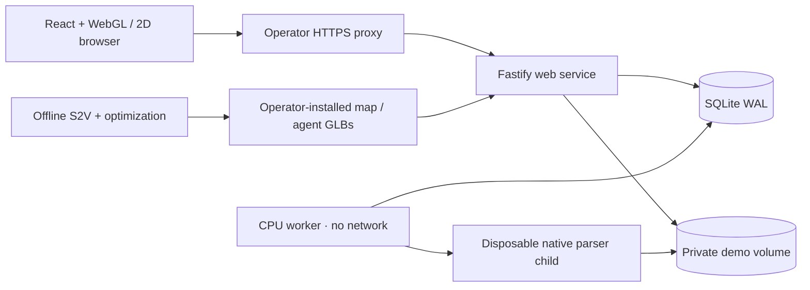

# Architecture

## Deployment and data flow

The web process authenticates requests and streams uploads. It does not parse demos or decompress untrusted files. The worker atomically claims a queued row and starts a separate Node process that imports the native Rust parser. Worker timeout kills the child process group. Container memory/process/CPU limits bound native allocations; V8 heap limits alone do not bound native memory.

One SQLite database and one local data volume make deployment and backup straightforward. This is a **single-host architecture**. Multiple workers can claim jobs, but share I/O and each need expansion/memory headroom. Do not mount SQLite on network storage or scale web replicas across hosts. A larger installation should replace the store with PostgreSQL, use object storage, and keep the replay/provider interfaces. No Redis is required for this release.

Queue states: `uploading → queued → processing → ready | failed`. Quotas reserve maximum upload size before accepting bytes, then record actual original size; prepared compressed output is added after success. Stale uploads expire. Interrupted parser jobs become failed after their deadline instead of endlessly retrying crash inputs. Failed originals remain until owner deletion or retention. Worker polling is two seconds; maintenance runs every minute.

## Replay contract

`shared/playback.d.ts` defines version 1. Player IDs are strings; positions/angles use Source coordinates. The parser samples player state at 16 Hz from recorded 64 Hz demo ticks, and the renderer interpolates positions and shortest-angle yaw between adjacent samples. Events retain recorded ticks. Round starts/live starts/ends and timeout/freeze segments come from parsed events/game rules. Grenade paths sample recorded projectiles; entity ID reuse is separated when there is a gap.

The server serves gzip JSON only after access checks. The browser currently loads the complete replay into memory; output is capped at 200 MB uncompressed. This is a known mobile limitation for long demos, not a claim of arbitrary-length mobile support. The next data improvement is versioned per-round chunks, bounded client caching, and a manifest endpoint. Preserve exact event ticks and continuous seek behavior when adding it.

Display settings live only in the browser. Account data, visibility, and notes stay on the server. The synthetic sample is deterministic and independent of database data. The 2D position plot needs no map asset or WebGL. Its lack of map geometry is explicit.

## Rendering and S2V

S2V exports game content offline, using its CLI and the operator's installed game files. The preparation tool packs textures into GLBs, optimizes them, emits desktop/mobile variants, and records version/hash information. Export/optimization is CPU work, not real-time server rendering. Assets are installed by the operator, not uploaded through a public API.

The browser loads map geometry and applies replay positions. Standard glTF PBR differs from Source 2's shaders. S2V map export omits important lighting/sky information; the current renderer uses approximate ambient/directional lighting. Event-based smoke/fire geometry is an analytical overlay, not volumetric smoke or exact fire coverage. Optional agent models use cloned skeletons and generic deterministic clip selection. Exact character poses, weapon/viewmodel attachments, animation graphs, audio, and game effects require additional work.

Desktop/mobile quality controls adjust resolution/shadows and select the prepared map tier. This is not a hardware benchmark; test transfer size, memory, sustained frame rate, and thermal behavior on actual target devices.

## Accounts and providers

A user owns credentials, sessions, demos, and notes. `identities(provider, subject, user_id)` separates external identities from accounts. This supports adding identities without changing ownership or trusting display names. Only Steam is currently a social login provider; FACEIT is a linked data source verified through Steam.

Adding another login provider requires a provider adapter with fixed authorization/token/userinfo origins, state and PKCE where appropriate, exact redirect URI validation, a verified immutable subject, a new env/admin policy flag, and callback tests. Reuse session issuance and identity uniqueness. Never implement account merging by nickname or email. Extract the growing provider route registry before adding several providers; the current two adapters do not justify an elaborate plugin framework.

Steam uses verified OpenID assertions. FACEIT Data API supplies profiles/history, and approved Downloads API supplies signed demo URLs. Downloads accept only authenticated upstream resource URLs on restricted HTTPS provider hosts, with no redirects. User input is a match ID. Steam next-match discovery returns share codes, not demo files; resolving/download access through Steam's Game Coordinator is not implemented.

## API shape

- `/api/config`, `/api/health`: non-secret instance config/health.
- `/api/auth/*`: local accounts, Steam, session management, password change.
- `/api/demos`: streamed uploads and paginated own/public lists.
- `/api/demos/:id`: detail, owner rename/visibility/delete.
- `/api/demos/:id/playback`: authorized prepared replay.
- `/api/demos/:id/bookmarks`, `/api/bookmarks/:id`: private notes.
- `/api/connections/*`: Steam discovery and verified FACEIT imports.
- `/api/maps/:name`, `/api/assets/agents`: installed asset discovery.
- `/api/admin`: admin-only policy, recent accounts, queue counts, audit events.

All API errors return a safe `detail`; raw provider responses, tokens, and native parser exceptions are not exposed. Unknown API paths return 404, never the SPA shell. Frontend routes fall back to the app shell after instance access policy checks.

## Public/product routing and localization

The public shell serves `/`, `/features/viewer`, `/features/imports`, and `/self-host`. The workspace shell serves `/library`, `/explore`, viewer and account routes. `docs/product/UX.md` is the route/access authority. In private mode the server may serve the generic frontend shell for known app routes so the user receives a useful sign-in gate; content APIs and map/agent files remain authenticated. This is not a frontend-only privacy check.

Steam auth state stores an allowlisted local `return_to` path (schema v2). The callback does not accept an arbitrary redirect origin. Local authentication preserves the current route, so an upload intent returns to the library and focuses the import control. Viewer links carry a local origin context for returning to landing/explore/library.

`frontend/src/i18n.ts` owns language persistence, locale selection and translation. Catalogs use English source messages as keys with key/namespace separators disabled. Dynamic user content is not translated. Add both catalogs when adding copy; `check:locales` and the catalog/placeholder tests catch omissions. Public and member components share `Brand.tsx` and semantic tokens in `brand.css`, while `public.css` owns marketing composition and `workspace.css` owns workspace structure. `styles.css` supplies common controls/viewer states.
