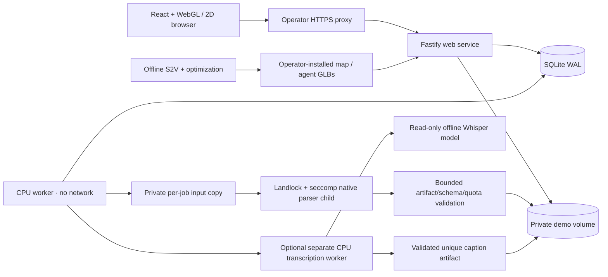

# Architecture

## Deployment and data flow

The web process authenticates requests and streams uploads. It does not parse demos or decompress untrusted files. The worker atomically claims a queued row, copies its input into a random job directory, and starts the native parser through a required Linux Landlock/seccomp launcher. The child reads runtime code/libraries and reads/writes only its job. Database, other demos and provider environment are outside its boundary. Forks, network and process escape are denied; native threads remain usable. Unsupported kernels fail closed. Timeout/cancellation kills the process group before output validation. Container memory/process/CPU limits bound native allocations; V8 heap limits alone do not bound native memory.

The parent incrementally polls bounded scratch files, validates compressed artifacts and versioned domain shapes, copies accepted regular files into a pending directory, and promotes them only if the row still owns the processing state and output fits quotas. Summary comes from the validated manifest. Failed publication removes promoted fragments; housekeeping reclaims stale jobs. Polling leaves a disk-write race, so host filesystem quotas remain the hard disk boundary. See `parser-job.ts`, `replay.ts` and SECURITY.md.

One SQLite database and one local data volume make deployment and backup straightforward. This is a **single-host architecture**. Multiple workers can claim jobs, but share I/O and each need expansion/memory headroom. Do not mount SQLite on network storage or scale web replicas across hosts. A larger installation should replace the store with PostgreSQL, use object storage, and keep the replay/provider interfaces. No Redis is required for this release.

Queue states: `uploading → queued → processing → ready | failed`. Quotas reserve maximum upload size before accepting bytes, then record actual original size; prepared compressed output is added after success. Stale uploads expire. Interrupted parser jobs become failed after their deadline instead of endlessly retrying crash inputs. Failed originals remain until owner deletion or retention. Worker polling is two seconds; maintenance runs every minute.

## Replay contract

`shared/playback.d.ts` defines the version 1 rendering domain and version 2 streamed transport. Player IDs are strings; positions/angles use Source coordinates. The parser samples player state at 16 Hz from recorded 64 Hz demo ticks, and the renderer interpolates positions and shortest-angle yaw between adjacent samples. Events retain recorded ticks. Round starts/live starts/ends and timeout/freeze segments come from parsed events/game rules. Native rows are grouped/sorted explicitly. Grenade paths sample recorded projectiles; entity ID reuse is separated when there is a gap.

The server checks access independently on the manifest and every chunk. New output consists of `manifest.json.gz` and `chunks/<index>.json.gz`. The manifest retains global events/rounds/dead-time indexes, whole-match ticks and Source-coordinate world bounds. Each chunk has at most 480 new samples, one shared end frame and 80 preceding frames for five seconds of trail context. Trajectories include adjacent points. Global bounds prevent camera/radar shifts between slices.

`replay-cache.ts` keeps at most three decoded slices and two current requests, prefetches forward and cancels irrelevant transfers on seek. `useReplay.ts` owns polling, identity-safe lifecycle, initial/legacy loading, buffering and retry. The controller owns user time/camera decisions; playback pauses during buffering. `playback.ts` stays independent of Three.js and uses the global last tick for timeout skips. Limits are 4 MiB decoded per chunk, 16 MiB metadata, 512 MiB aggregate decoded chunks and 160 MiB stored output, validated before publication. Existing `playback.json.gz` version 1 data remains readable as a whole; re-upload prepares version 2. These bounds do not certify real-device performance.

Display settings live only in the browser. Account data, visibility, and notes stay on the server. The synthetic sample is deterministic and independent of database data. The 2D position plot needs no map asset or WebGL. Its lack of map geometry is explicit.

Recorded input/economy fields are optional and accompanied by explicit capabilities. Optional native query groups fall back independently; unavailable input must not erase available money/equipment data. Button masks stay uint64 decimal strings. Key labels are conventional actions (WASD/ZQSD), not recovered physical bindings; input state is sampled at 16 Hz. `review-events.ts` groups round events and matches player IDs; `RoundEvents` and `ReviewHud` provide progressive presentation.

## Communications and CPU subtitles

`communications.ts` uses the typed `cs2parser` reader with entities disabled, inside the existing parser sandbox. `voice-packets.ts` validates bounded Steam containers/CRC and raw Opus framing; unsupported data produces a capability/warning, never guessed speech. The manifest holds bounded text chat and communication status; chunks hold bounded voice packets with immutable speaker IDs and recorded times. `voice-playback.ts` decodes locally with trusted bundled libopus WASM, caps decoder/scheduling state, and resets scheduled audio on seeks/pauses. CSP permits WebAssembly compilation without permitting general JavaScript eval. Recorded communications share their demo's access policy.

Schema v4 adds an independent transcription state, start time, claim lease, byte count and artifact pointer. Optional `transcription-worker.ts` claims ready replay jobs without changing primary replay status. It copies validated slices, grants a dedicated model directory read-only, and starts `transcription-job.js` under the same kernel boundary. Local-only Whisper CPU inference groups bounded speaker utterances, suppresses silent input, detects or accepts a language, and emits timed cues. Parent validation checks bounds/speakers/content/size before publication. Unique `captions-<lease>.json.gz` artifacts and a transactional DB pointer prevent stale workers or rollback from replacing another result. Quotas include captions. Cancellation, graceful shutdown and stale/orphan cleanup preserve the ready replay.

`WORKER_ROLE=parse|transcription|all` separates scheduling; Compose uses a normal parser and an optional networkless transcription profile so long speech jobs do not delay uploads. Runtime model downloads/cloud fallback are disabled. `tools/transcription` prepares checksum-pinned weights and public speech fixtures offline from the application. `Communications.tsx` owns optional voice/chat/subtitle controls and caption polling; outputs are approximate and carry provenance. Text is rendered as text, never HTML. Encrypted or missing content stays unavailable.

## Rendering and S2V

S2V exports game content offline, using its CLI and the operator's installed game files. The preparation tool packs textures into GLBs, optimizes them, emits desktop/mobile variants, and records version/hash information. Export/optimization is CPU work, not real-time server rendering. Assets are installed by the operator, not uploaded through a public API.

The browser loads map geometry and applies replay positions. Standard glTF PBR differs from Source 2's shaders. S2V map export omits important lighting/sky information; the current renderer uses approximate ambient/directional lighting. Event-based smoke/fire geometry is an analytical overlay, not volumetric smoke or exact fire coverage. Optional agent models use cloned skeletons and generic deterministic clip selection. Exact character poses, weapon/viewmodel attachments, animation graphs, audio, and game effects require additional work.

Desktop/mobile quality controls adjust resolution/shadows and select the prepared map tier. This is not a hardware benchmark; test transfer size, memory, sustained frame rate, and thermal behavior on actual target devices.

## Accounts and providers

A user owns credentials, sessions, demos, and notes. `identities(provider, subject, user_id)` separates external identities from accounts. This supports adding identities without changing ownership or trusting display names. Only Steam is currently a social login provider; FACEIT is a linked data source verified through Steam.

Adding another login provider requires a provider adapter with fixed authorization/token/userinfo origins, state and PKCE where appropriate, exact redirect URI validation, a verified immutable subject, a new env/admin policy flag, and callback tests. Reuse session issuance and identity uniqueness. Never implement account merging by nickname or email. Extract the growing provider route registry before adding several providers; the current two adapters do not justify an elaborate plugin framework.

Steam uses verified OpenID assertions. FACEIT Data API supplies profiles/history, and approved Downloads API supplies signed demo URLs. Downloads accept only authenticated upstream resource URLs on restricted HTTPS provider hosts, with no redirects. User input is a match ID. Steam next-match discovery returns share codes, not demo files; resolving/download access through Steam's Game Coordinator is not implemented.

## API shape

- `/api/config`, `/api/health`: non-secret instance config/health.
- `/api/auth/*`: local accounts, Steam, session management, password change.
- `/api/demos`: streamed uploads and paginated own/public lists.
- `/api/demos/:id`: detail, owner rename/visibility/delete.
- `/api/demos/:id/playback`: authorized prepared replay.
- `/api/demos/:id/playback/chunks/:index`: authorized version 2 time slice.
- `/api/demos/:id/captions`: authorized caption status/artifact; `/captions/retry` is owner-only with CSRF/origin/rate policy.
- `/api/demos/:id/bookmarks`, `/api/bookmarks/:id`: private notes.
- `/api/connections/*`: Steam discovery and verified FACEIT imports.
- `/api/maps/:name`, `/api/assets/agents`: installed asset discovery.
- `/api/admin`: admin-only policy, recent accounts, queue counts, audit events.

All API errors return a safe `detail`; raw provider responses, tokens, and native parser exceptions are not exposed. Unknown API paths return 404, never the SPA shell. Frontend routes fall back to the app shell after instance access policy checks.

## Public/product routing and localization

The public shell serves `/`, `/features/viewer`, `/features/imports`, and `/self-host`. The workspace serves `/library`, `/explore` and account routes. `WorkspaceShell` owns work navigation; `AccountMenu` contains account, connections and administration. `/account/connections` is canonical; `/connections` redirects. The whole-tab viewer has a separate shell. `docs/product/UX.md` is the route/access authority. Private mode may serve the generic frontend shell for a useful sign-in gate; content APIs and map/agent files remain authenticated independently.

Steam auth state stores an allowlisted local `return_to` path (schema v2). The callback does not accept an arbitrary redirect origin. Local authentication preserves the current route, so an upload intent returns to the library and focuses the import control. Viewer links carry a local origin context for returning to landing/explore/library.

`frontend/src/i18n.ts` owns language persistence, locale selection and translation. Catalogs use English source messages as keys with key/namespace separators disabled. Dynamic user content is not translated. Add both catalogs; `check:locales` and catalog/placeholder tests catch omissions. Public/member components share `Brand.tsx` and semantic tokens. `public.css` owns approved marketing composition; `member.css` scopes member/viewer styling over legacy foundations in `styles.css`/`workspace.css`. `Controls.tsx` and `member-controls.css` own accessible menus/selects; portals stay inside native dialogs/fullscreen and own their theme tokens. Delete obsolete selectors rather than stack more overrides.

## Provider downloads

`remote-download.ts` implements restricted provider resources with an exact host policy, conservative public DNS validation, one pinned TLS address, no redirects and streaming byte/time bounds. FACEIT selects authenticated upstream resources by match ID. There is no arbitrary client URL fetch endpoint or HLTV scraping/catalog wrapper; external demos use normal file uploads.
